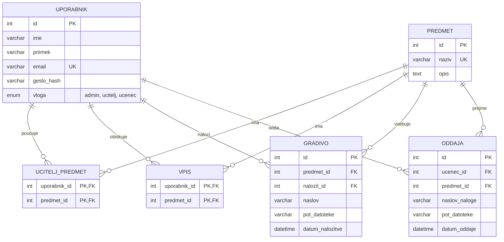

# ER diagram podatkovne baze

## Opis tabel
| Tabela | Opis | Ključi |
|--------|------|--------|
| `UPORABNIK` | Vsi uporabniki, ločeni po stolpcu `vloga`. | PK `id`, UNIQUE `email` |
| `PREDMET` | Šolski predmeti. | PK `id`, UNIQUE `naziv` |
| `UCITELJ_PREDMET` | Veznik M:N: kateri učitelj poučuje kateri predmet. | sestavljen PK, oba FK |
| `VPIS` | Veznik M:N: kateri učenec obiskuje kateri predmet. | sestavljen PK, oba FK |
| `GRADIVO` | Gradiva, ki jih učitelj naloži k predmetu. | PK `id`, FK `predmet_id`, `nalozil_id` |
| `ODDAJA` | Naloge, ki jih učenci oddajo pri predmetu. | PK `id`, FK `ucenec_id`, `predmet_id`, UNIQUE (`ucenec_id`, `predmet_id`, `naslov_naloge`) |

## Odločitve
- **Ena tabela za uporabnike:** poenostavi prijavo in avtorizacijo. Aplikacija mora zagotoviti, da `UCITELJ_PREDMET` vsebuje samo učitelje in `VPIS` samo učence.
- **UNIQUE na `ODDAJA`:** ponovna oddaja iste naloge posodobi obstoječo vrstico (po potrditvi učenca).
- **Brisanje:** `UCITELJ_PREDMET` in `VPIS` imata `ON DELETE CASCADE`. Predmeta z gradivi ali oddajami se ne izbriše brez potrditve (`RESTRICT` ali kaskada po dogovoru).
- **Normalizacija:** tabele so v 3. normalni obliki; datoteke so na disku, v bazi je samo pot.
