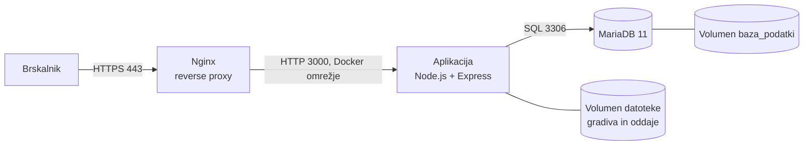

# Tehnična dokumentacija

## 1. Arhitektura



Vsi trije vsebniki so v skupnem Docker omrežju. Navzven sta odprti samo vrati 80 (preusmeritev na HTTPS) in 443. Baza in aplikacija nista neposredno dostopni z interneta.

## 2. Izbira tehnologij
| Področje | Izbira | Utemeljitev |
|----------|--------|-------------|
| Ogrodje | Node.js 20 + Express + EJS | enostavno, malo kode, dobra dokumentacija |
| SUPB | MariaDB 11 | relacijski model, uradna Docker slika |
| Strežnik | Ubuntu Server 24.04 | stabilen, dolgoročna podpora |
| Proxy | Nginx | HTTPS, preusmeritev, omejitev velikosti nalaganja |
| Potrdilo | Let's Encrypt (Certbot) | brezplačno, obnovljivo |
| Gesla | bcrypt (bcryptjs, 10 krogov) | priporočilo OWASP, gesla nikoli v čistem besedilu |

## 3. Namestitev na strežnik (Ubuntu)
```bash
# 1. Docker
sudo apt update && sudo apt install -y docker.io docker-compose-v2 git openssl
sudo usermod -aG docker $USER   # nato ponovna prijava

# 2. Koda
git clone https://github.com/UPORABNIK/rps.git && cd rps
cp .env.example .env && nano .env      # vpišite močna gesla

# 3. Začasno samopodpisano potrdilo in zagon
./skripte/certifikat-samopodpisan.sh
docker compose up -d --build

# 4. Požarni zid
sudo ufw allow 22 && sudo ufw allow 80 && sudo ufw allow 443 && sudo ufw enable
```
Okolje se zažene z enim ukazom (`docker compose up -d`). Ob prvem zagonu se ustvari shema baze (`baza/01_shema.sql`), aplikacija pa vnese testne podatke.

## 4. Javna domena in HTTPS
1. Pridobite domeno ali poddomeno (šola, DuckDNS ali registrar).
2. Pri ponudniku DNS dodajte zapis **A**, ki kaže na javni IP strežnika. Preverite z `nslookup domena`.
3. Če strežnik stoji za usmerjevalnikom, preusmerite vrati 80 in 443 nanj.
4. Zaženite: `./skripte/certifikat-letsencrypt.sh domena.si ime@posta.si`
5. Potrdilo obnovite mesečno (cron: ponoven zagon istega skripta).

## 5. Varnostne kopije
`./skripte/backup.sh` izdela stisnjeno kopijo baze v `backup/` in briše kopije, starejše od 14 dni. Dnevno izvajanje: cron, vrstica je v glavi skripta. Obnova je opisana na dnu skripta. Datoteke (gradiva, oddaje) so v Docker volumnu `datoteke`.

## 6. Varnostne odločitve
- Gesla zgoščena z bcrypt, najmanj 8 znakov.
- Avtorizacija po vlogi na strežniku pri vsaki poti.
- Učitelj dostopa samo do gradiv in oddaj predmetov, ki jih poučuje; učenec samo do svojih predmetov in svojih oddaj.
- Naložene datoteke so izven javne mape; dostop samo prek `/datoteka/...` s preverjanjem pravic.
- Poizvedbe z vezanimi parametri (SQL injekcija), EJS ubežnica izpis (XSS).
- Omejitev velikosti (10 MB) in dovoljenih končnic pri oddaji nalog.
- Skrivnosti v `.env`, ki ni v repozitoriju.
- Znana omejitev: ni zaščite pred CSRF in ni omejevanja poskusov prijave (predlog za nadaljnji razvoj).

## 7. Struktura kode
```
aplikacija/app.js        poti, avtorizacija, poslovna logika
aplikacija/seed.js       testni podatki
aplikacija/views/*.ejs   predloge pogledov
baza/01_shema.sql        shema (6 tabel)
nginx/nginx.conf         reverse proxy in HTTPS
skripte/                 potrdila, varnostne kopije
```

## 8. Poti aplikacije
| Pot | Vloga | Namen |
|-----|-------|-------|
| `/prijava`, `/registracija`, `/odjava` | vsi | prijava, registracija učenca |
| `/admin/predmeti`, `/admin/ucitelji`, `/admin/ucenci` | admin | CRUD |
| `/admin/dodelitve` | admin | učitelj–predmet, učenec–predmet |
| `/ucitelj/gradiva`, `/ucitelj/oddaje` | učitelj | gradiva, pregled oddaj |
| `/ucenec/profil`, `/ucenec/predmeti`, `/ucenec/gradiva`, `/ucenec/oddaja` | učenec | profil, predmeti, gradiva, oddaja |
| `/datoteka/gradivo/:id`, `/datoteka/oddaja/:id` | prijavljeni | prenos s preverjanjem pravic |
